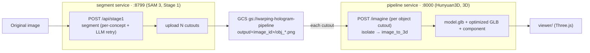

# Architecture — segment → 3D (two microservices)

Two independent services, wired by a **GCS folder-per-image** contract. One original image is
segmented into N objects (Stage 1), each object is turned into 3D (Stage 2).

| Service | Dir | Port | Endpoint | Role |
|---|---|---|---|---|
| **segment** (Chinmay) | `segment/` | 8799 | `POST /api/stage1` | SAM 3 → N object cutouts → upload to `output/<image_id>/` |
| **pipeline** (Prannay) | `pipeline/` | 8000 | `POST /imagine` | cutout → BiRefNet isolate → Hunyuan3D v3 → GLB + Three.js component |

Both start together via [`run-services.sh`](run-services.sh).

## Integration diagram



## The contract (why folder-per-image)
One input image usually has **more than one object**, so Stage 1 writes a **folder per input image**:
```
gs://warping-hologram-pipeline/
  input/<original>.jpg
  output/<image_id>/            # image_id = sha256(image_url)[:16]
    person_0.png  car_1.png  star_2.png   # N object cutouts
```
Stage 2 iterates the folder: each `output/<image_id>/*.png` → `POST /imagine` → one GLB. The
`pipeline` service is idempotent (keyed by SHA of the bytes), so re-sending a cutout is a cache hit.

## Run
```bash
cp segment/.env.example segment/.env     # FAL_KEY, GCS_BUCKET
cp pipeline/.env.example pipeline/.env    # FAL_KEY
./run-services.sh                         # segment :8799 + pipeline :8000
```
GCS auth for `segment`: ADC (`gcloud auth application-default login`) or `GOOGLE_APPLICATION_CREDENTIALS`.

The glue (download each `output/<image_id>/*` → `POST /imagine` → collect GLB URLs) is a thin
orchestrator that lives between the two services — today a script/notebook, tomorrow a workflow (below).

## Future scope — one generic Temporal workflow
Right now the two services are loosely coupled through GCS + a hand-rolled glue step. The natural
next step is a **single durable Temporal workflow** that orchestrates the whole thing, so retries,
timeouts, and fan-out are first-class instead of ad-hoc:

```
HologramWorkflow(image, prompt):
    seg   = segment_activity(image, prompt)              # Stage 1 (this repo's segment service logic)
    parts = [ imagine_activity(cutout)                   # fan-out: one 3D job per object, in parallel
              for cutout in seg.cutouts ]                # each = the pipeline service's /imagine
    return collect_glbs(parts)
```
- **Generic pipeline:** activities become swappable stages (`segment_activity`, `imagine_activity`,
  `upload_activity`), so the same workflow serves other segment/3D backends by swapping an activity —
  the model choice stops being hard-coded into the service.
- **Where it already exists:** `floating-objects/temporal_pipeline/` has the scaffold (workflow +
  activities + `run-with-temporal.sh`) with liberal timeouts and one-retry-on-costly-steps. Folding
  `pipeline`'s `/imagine` in as `imagine_activity` (fan-out over the `output/<image_id>/` folder)
  turns these two microservices into one orchestrated, replayable pipeline.
- **Fan-out + fault isolation:** each object's 3D job retries independently; a slow/failed object
  doesn't block the rest of the scene.
