# Hologram

Point a photo at the server; the objects in it pop out of the frame as a placed
3D hologram scene, each on a glowing leader line with its own info card.

Built by team **Warping** for the fal x Sequoia 72-Hour Video Hackathon
(Developer Track). `POPFRAME` is the codename you'll see throughout the code.

**Live app:** [popframe-production.up.railway.app/app/hologram.html](https://popframe-production.up.railway.app/app/hologram.html)
· **Demo video:** [popframe-demo.vercel.app](https://popframe-demo.vercel.app)

## What it does

Give it a photo or a short video and a prompt like `"person, dog, chair"`:

1. **framepick** — for video, grab a readable frame; for photos, use as-is.
2. **SAM 3** segments each named concept into a cutout + mask (with an LLM
   retry that rewrites a concept into a more common word when SAM finds
   nothing).
3. **SAM 3D Align** (`fal-ai/sam-3/3d-objects`) reconstructs every object as a
   mesh and — the important part — **places them all in one shared scene**, so
   relative position and scale come from the photo, not from us.
4. **describe** — Claude writes a short name, tags, and facts per object.
5. The **Three.js viewer** freezes the original frame as a backdrop and pops
   each object out of it along a leader line, hovering in front of the frame
   with a sci-fi HUD card.

Optionally, any single object can get a **hero upgrade**: the existing
`/imagine` pipeline (BiRefNet isolate → orbit multiview → Hunyuan3D v3 →
optimized GLB) replaces the scene-grade mesh with a much better one.

## The demo moment

A flat photo on screen. Click "SCAN". The photo freezes, tilts back,
and the dog, the person, and the chair lift out of it as real 3D meshes —
still standing exactly where they stood in the photo — each with a glowing
line back to its spot in the frame and a card naming it. Orbit around them.
Then click the dog and watch it swap for a hero-quality Hunyuan3D mesh.

## Architecture

```mermaid
flowchart LR
  in["photo / video"]

  subgraph SCENE["scene path · pipeline :8000 · POST /api/scene · ~40s uncached"]
    direction LR
    fp["framepick<br/>(video → frame)"]
    s3["SAM 3<br/>segment named objects<br/>+ LLM concept retry"]
    align["SAM 3D Align<br/>fal-ai/sam-3/3d-objects<br/>one shared, placed scene"]
    desc["describe<br/>Claude → name/tags/facts"]
    fp --> s3 --> align --> desc
  end

  viewer["Three.js pop-out viewer<br/>frozen frame + leader lines + HUD cards"]

  subgraph HERO["hero upgrade · POST /imagine · ~3min"]
    direction LR
    bi["BiRefNet isolate"] --> mv["orbit multiview"] --> hy["Hunyuan3D v3"] --> glb["optimized GLB<br/>+ native Three.js"]
  end

  in --> fp
  desc -->|"Scene3D JSON"| viewer
  viewer -->|"per-object upgrade"| bi
  glb --> viewer
```



The seam between backend and viewer is one JSON shape, `Scene3D`: a
`scene_glb_url`, the frozen `frame_url`, and an `objects[]` list where each
object carries `label`, `glb_url`, `cutout_url`, `bbox`, `score`, an
`info` card (`name`, `tags`, `facts`), and a `transform`. The transform
matters: Align's combined GLB ships **identity** node transforms (every mesh
unit-normalized at the origin), so the true placement lives only in the
response metadata. The backend converts that per-object TRS (PyTorch3D camera
frame, row-form wxyz quaternion) into a ready-to-apply three.js transform
(`position [x,y,z]`, `rotation [x,y,z,w]`, `scale [x,y,z]`; raw metadata kept
under `align_meta`), and the viewer applies it to the named GLB node instead
of trusting the file. Everything degrades gracefully: if Align fails the
viewer still shows 2D cutout cards; if describe fails the info fields are
just empty. Partial beats nothing.

## Repo layout

- `segment/` — stdlib HTTP service on :8799 — SAM 3 segmentation + SAM 3D
  Align calls (`pipeline_core.py`), Stage 1 GCS upload.
- `pipeline/` — FastAPI service on :8000 — the scene endpoints, the `/imagine`
  hero pipeline (BiRefNet → multiview → Hunyuan3D → GLB → native JS
  transpile), content-addressed outputs, the studio UI
  (`outputs/imagine/studio.html`).
- `viewer/` — vite + Three.js pop-out hologram viewer.

## Quickstart

```bash
# backend (python via uv)
cd pipeline
uv sync
cp .env.example .env        # FAL_KEY
uv run uvicorn pipeline.server:app --host 0.0.0.0 --port 8000

# segment service (optional standalone; scene path also works through :8000)
cd ../segment
pip install fal-client
cp .env.example .env        # FAL_KEY
python3 server.py           # :8799

# viewer
cd ../viewer
npm install
npm run dev
```

`ANTHROPIC_API_KEY` powers the describe step (info cards); if it's missing or
invalid the scene path falls back to fal `any-llm/vision`, and if that fails
too the info fields are just empty. Both services print LAN-aware URLs so a
phone on the same network can hit them directly.

## API surface

| Endpoint | What it does |
|---|---|
| `POST /api/scene` | photo/video + prompt → `Scene3D` JSON (segment → Align → describe). No object matches → `objects: []`, Align is never called. |
| `GET /api/scene/{id}` | replay a cached scene by id (`cached: true`) — powers the viewer deep link `hologram.html?scene=<id>`. |
| `GET /api/scenes` | list previously built scenes on disk. |
| `POST /imagine` | one photo → hero-quality 3D (GLB + typed r3f component + native Three.js source). |
| `POST /imagine/batch` | 2–8 photos, processed concurrently; each result independent. |
| `GET /api/health` | liveness + LAN URLs. |
| `/files/...` | static mount for every generated artifact. |

## Caching & idempotency

Every request is content-addressed: `sha256(input bytes + prompt)` keys the
work directory. A duplicate request — same photo, same prompt — returns
instantly with `cached: true`, whether it's a scene or a hero mesh. Results
live on disk under `pipeline/outputs/` with a durable manifest, so a server
restart loses nothing and the studio sidebar survives. In-flight duplicates
dedupe via per-digest locks, so double-clicking "SCAN" costs one fal call,
not two.

## Known limits

- Align meshes are **scene-grade**: right shape, right place, soft detail.
  That's what the hero upgrade is for.
- Transparent and reflective objects (glass, mirrors, screens) segment fine
  but reconstruct poorly.
- Uncached latency: ~40s for a scene, ~3min for a hero upgrade. Cached: instant.
- Video handling picks one readable frame; there is no temporal fusion. A
  video with no readable frames returns a 400 with a clear message.
- Align can succeed on the scene but miss an individual object — that object
  keeps its cutout card with `glb_url: null` and the rest of the scene is
  unaffected.
