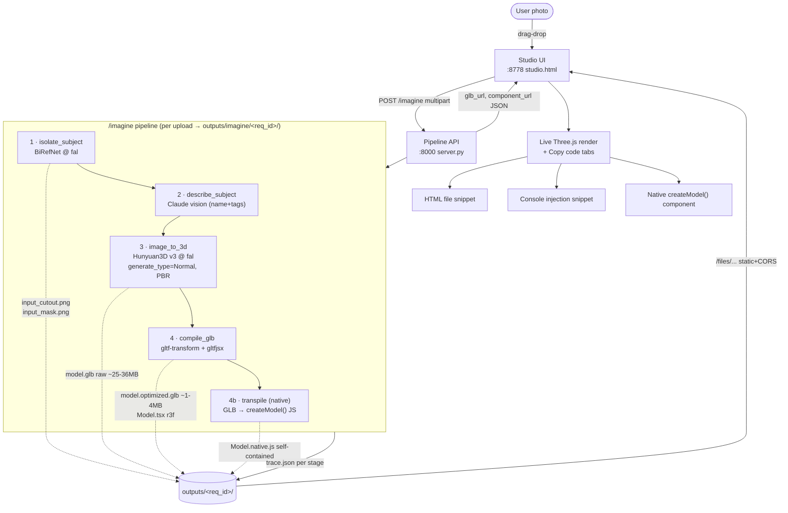

# Image → 3D → Three.js — Workflow

## The idea in one line
Upload a photo → isolate the subject → generate a full 3D mesh (invented backside) →
compile to web-ready 3D → view it and copy a Three.js component you can reuse anywhere.

## High-level flow



## What each stage does (and the format at each hop)

| # | Stage | Tool / model | In → Out |
|---|-------|--------------|----------|
| 1 | **isolate_subject** | BiRefNet (fal) | photo → background-removed cutout PNG + mask + fal-hosted cutout URL |
| 2 | **describe_subject** | Claude vision (Anthropic) | photo → `{name, tags}` (semantic only, optional) |
| 3 | **image_to_3d** | Hunyuan3D v3 (fal) | cutout URL → **model.glb** (textured PBR mesh, ~500k tris, invents the unseen back) |
| 4 | **compile_glb** | gltf-transform + gltfjsx | raw GLB → **model.optimized.glb** (meshopt, 1–4 MB) + **Model.tsx** (react-three-fiber wrapper) |
| 4b | **transpile** | custom (trimesh + numpy) | GLB → **Model.native.js** — `createModel(): THREE.Mesh` built from inlined geometry + vertex colors, no loader/assets |

## The two output philosophies

```
              ┌── model.optimized.glb  +  Model.tsx  ──►  loads GLB at runtime (r3f wrapper)
   raw GLB ───┤
              └── Model.native.js  ──────────────────►  geometry CONSTRUCTED in code
                                                          (no GLTFLoader, no .glb, vertex colors)
```

## Services & ports

| Piece | Port | Role |
|-------|------|------|
| Studio UI (static) | **8778** | sidebar image picker, live render, upload, copy-code |
| Pipeline API | **8000** | `/imagine` upload endpoint; serves outputs at `/files` |
| fal.ai | — | BiRefNet (cutout) + Hunyuan3D v3 (image→3D) |
| Anthropic | — | describe_subject (name/tags) |
| cloudflared tunnel | — | optional public HTTPS so copied snippets work off-LAN |

## Artifacts written per generation → `outputs/imagine/<req_id>/`
```
input.jpg              the upload
input_cutout.png       BiRefNet subject cutout
input_mask.png         BiRefNet mask
model.glb              raw textured mesh from Hunyuan3D
compiled/
  model.optimized.glb  meshopt-compressed, web-ready
  Model.tsx            react-three-fiber component
trace.json             per-stage timings + ok/fail (the audit log)
```
Latency: ~3–4 min/generation (dominated by Hunyuan3D). Design the UX async.
